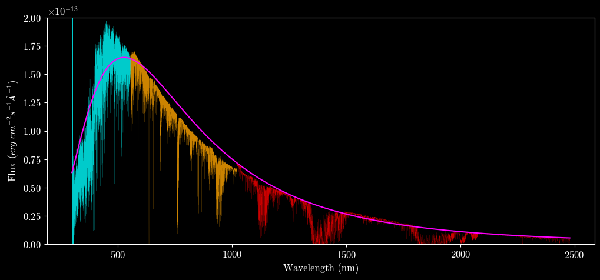
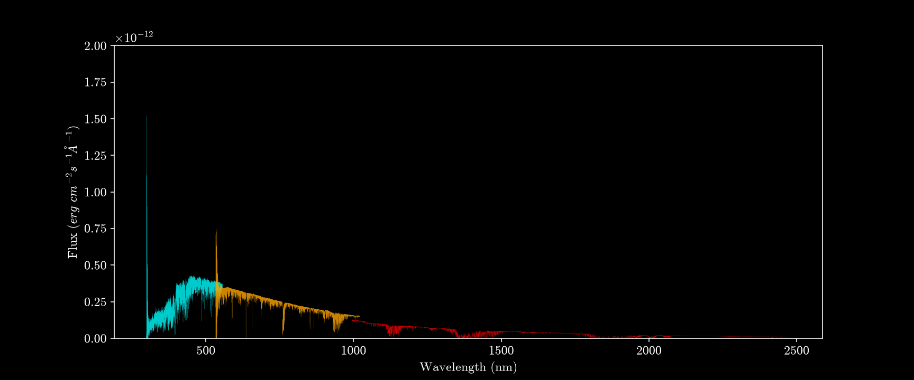
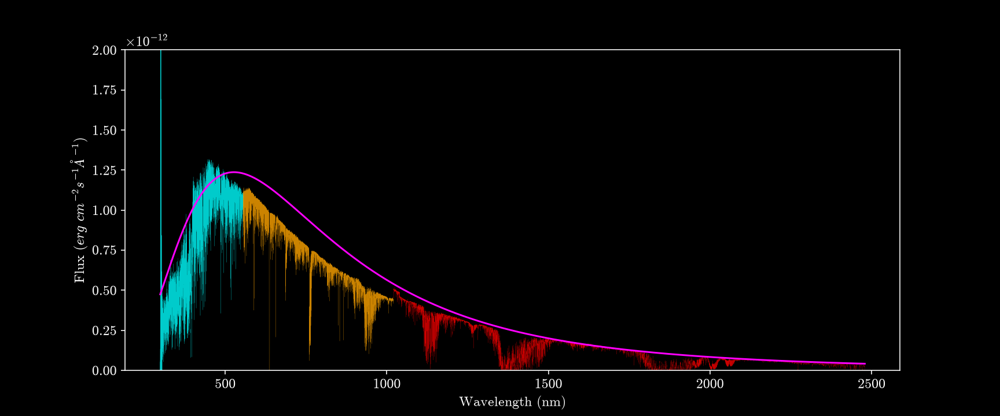
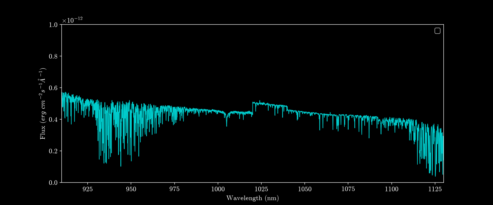

# **Stellar Atmosphere Modelling**

#### Comparing X-shooter observed spectra of low to intermediate mass stars and comparing to stellar photosphere models

How well do stellar atmosphere models reproduce zero age main sequence (ZAMS) star spectra.

